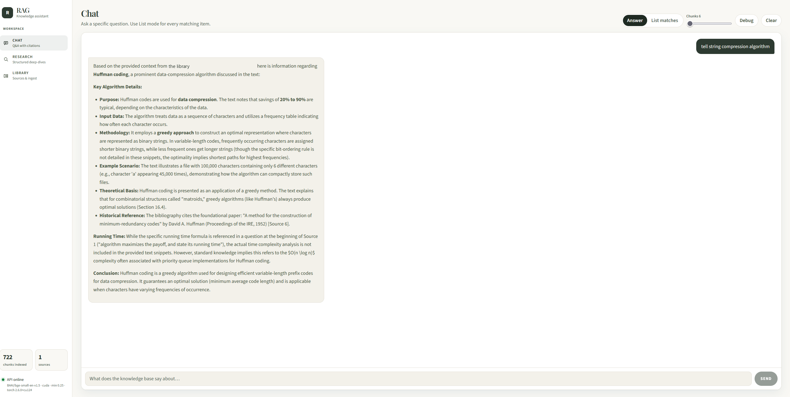
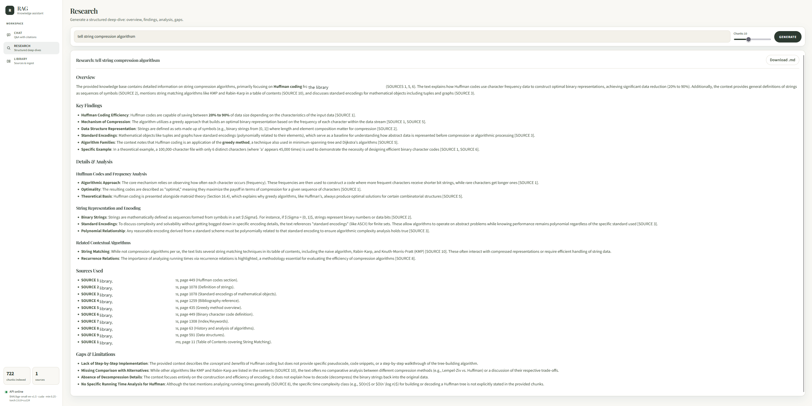
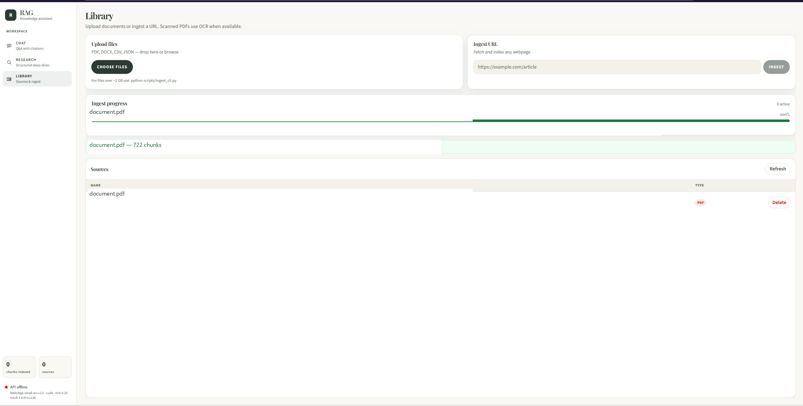
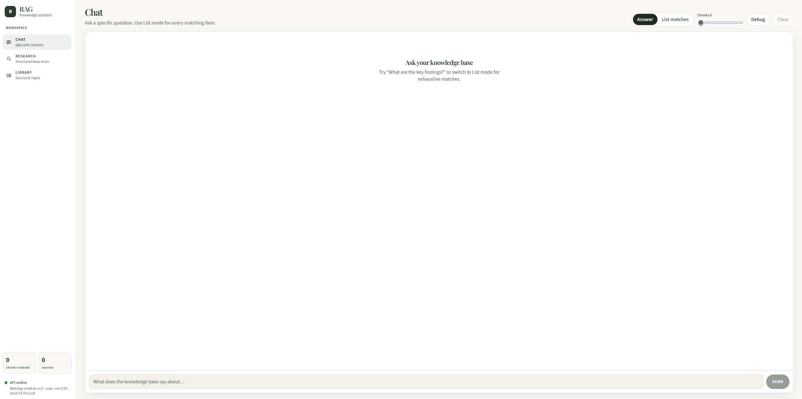
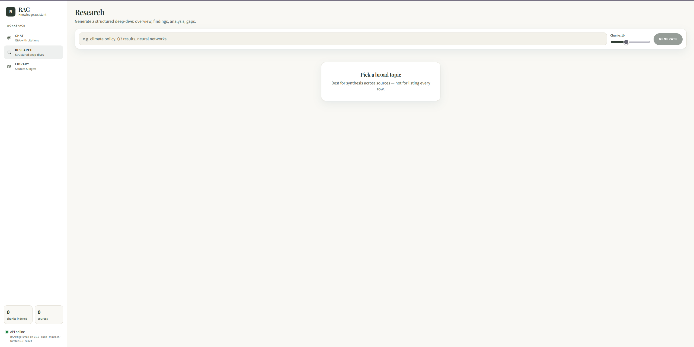

# RAG — Retrieval-Augmented Generation

This is a private reading room for your own files. You ingest documents once. Later you ask questions or request a research write-up, and the answer is written from passages in that library rather than from a model's general memory alone.

Everything stays on your machine. Embeddings and the language model both run locally. The question path does not call a cloud LLM.

How the pieces fit together is in [ARCHITECTURE.md](ARCHITECTURE.md). Agents changing this repo should read [context.md](context.md) first. This README is for people running the app.

## Screenshots

**Chat.** Ask a question. The reply is written from passages in your library.



**Research.** A longer report: overview, findings, analysis, sources, and gaps. Download it as Markdown when it finishes.



**Library.** Drop a file or paste a URL. Ingest shows progress, then the source appears in the list.



The same screens before anything is indexed:





## Two models, two jobs

The system uses two different models, and they are not interchangeable.

| Model | When it runs | What it does |
|-------|----------------|--------------|
| Embedding model (`BAAI/bge-small-en-v1.5` by default) | Ingest and every search | Turns text into vectors and finds similar passages in ChromaDB |
| Ollama LLM (`OLLAMA_MODEL`, for example `qwen3.5:9b`) | Chat and Research only | Reads the retrieved passages and writes the reply |

Ingest never calls Ollama. Changing the chat model is only an `.env` edit and a restart. Changing the embedding model invalidates the index: delete `local_data/chroma_db`, start again, and ingest the library once more.

## What you can do

- **Library** stores PDF, Word, CSV, JSON, and web pages. Scanned PDFs fall back to Tesseract when a page has almost no extracted text. Jobs show progress and can be cancelled.
- **Chat** answers a specific question, or lists every match. Stop aborts generation. Debug shows the passages that were retrieved.
- **Research** writes a longer report with overview, findings, analysis, and gaps, then offers a Markdown download.
- **CLI** ingests a file, a URL, or a folder without opening the UI. Use it for very large files.

## How a session runs

Three processes are involved. The start script launches two of them. You start Ollama yourself.

```
Browser  →  Vite :5173  →  /api/* proxy  →  FastAPI :8000
                                              ├─ ChromaDB  (local_data/chroma_db)
                                              └─ Ollama    (:11434, already running)
```

`start.bat` (Windows) or `start.sh` (macOS/Linux) does the following from the project root:

1. Refuses to start if `.env` is missing.
2. Loads that file into the environment for the API process.
3. Creates `local_data/uploads`, `local_data/chroma_db`, and `local_data/logs` if they are absent, and checks that the vector folder is writable.
4. Stops anything already listening on the API and UI ports.
5. Starts `uvicorn backend.api:app` with reload, then waits until `GET /health` succeeds.
6. Starts `npm run dev` in `frontend/`, then waits until the UI port answers.
7. Stays in the foreground. Ctrl+C stops both processes. `stop.bat` / `stop.sh` does the same from another window.

The UI is http://127.0.0.1:5173. API docs are http://127.0.0.1:8000/docs. The page never talks to port 8000 directly. Vite receives `/api/...` and forwards it to FastAPI with the `/api` prefix removed. Ollama is reached only by the API, at `OLLAMA_BASE_URL`.

Keep `API_HOST` on `127.0.0.1`. The API has no login.

## How a document becomes searchable

1. The file is saved under `local_data/uploads` (or the page is fetched, for a URL).
2. A loader reads it. PDFs use PyMuPDF. A page with fewer than about 50 characters of text is sent through Tesseract when OCR is enabled. Word, CSV, JSON, and HTML each have their own loader.
3. Unreadable or garbage text is dropped.
4. The rest is split into chunks of about 800 characters with 100 characters of overlap.
5. The embedding model encodes each chunk. ChromaDB stores the vector plus metadata (source path, type, page, filename).

After that, the original file can stay on disk, but search uses the index. Deleting a source in Library removes its chunks from Chroma. It does not delete the uploaded file.

## How a question becomes an answer

1. The question is embedded with the same model used at ingest.
2. Chroma returns the nearest chunks. Hits below `MIN_RELEVANCE_SCORE` (default `0.25`) are discarded.
3. Those passages are placed in a prompt. Chat can synthesize an answer or enumerate matches. Research asks for a fixed report outline.
4. Ollama streams tokens back. The UI appends them as they arrive. Stop closes the Ollama connection immediately, including when the model is still inside a long read.

Debug mode adds one extra call, `POST /retrieve`, so you can see the passages before or beside the written answer. Normal Chat does not do that. The API retrieves once inside `/ask/stream`.

## Requirements

- Python 3.10+
- Node.js 18+
- [Ollama](https://ollama.com/) running locally, with the model named in `.env` pulled (`ollama pull qwen3.5:9b` or whatever you set)
- Optional, for scanned PDFs: Tesseract and Poppler on `PATH`

## Setup

```powershell
cd rag_project
python -m venv .venv
.\.venv\Scripts\Activate.ps1
pip install -r requirements.txt
cd frontend
npm install
cd ..
Copy-Item .env.example .env
```

On macOS or Linux, activate with `source .venv/bin/activate` and copy `.env.example` to `.env`.

`uvloop` is Unix-only and is skipped on Windows by the `sys_platform` marker in `requirements.txt`.

NVIDIA GPU embeddings need a CUDA PyTorch wheel. A `+cpu` build will stay on CPU even if a GPU is present:

```powershell
pip uninstall torch -y
pip install torch --index-url https://download.pytorch.org/whl/cu124
python -c "import torch; print(torch.__version__, torch.cuda.is_available())"
```

Scanned PDFs:

```powershell
winget install --id UB-Mannheim.TesseractOCR
winget install --id oschwartz10612.Poppler
```

```bash
brew install tesseract poppler
# or: sudo apt install tesseract-ocr poppler-utils
```

`PDF_OCR_ENABLED=true` by default. An ingest that adds 0 chunks usually means the file had no readable text, or OCR is missing.

## Run

Windows, from the project root. This uses `.venv` when it exists:

```powershell
.\start.bat
.\stop.bat
```

`start.bat` and `stop.bat` launch the PowerShell scripts with execution policy bypass for that process. `.\start.ps1` and `.\stop.ps1` work when scripts are already allowed. Ctrl+C in the start window stops the API and the UI.

macOS / Linux:

```bash
chmod +x start.sh stop.sh
./start.sh
./stop.sh
```

Manual alternative: `uvicorn backend.api:app --host 127.0.0.1 --port 8000 --reload` in one terminal, and `npm run dev` inside `frontend/` in another.

- UI: http://127.0.0.1:5173
- API docs: http://127.0.0.1:8000/docs

Keep `API_HOST` on `127.0.0.1`. The API has no authentication.

## Use

**Library.** Drop files or paste an `http`/`https` URL. Watch ingest progress. Cancel is available while a job is running.

Large corpora:

```bash
python scripts/ingest_cli.py path/to/document.pdf
python scripts/ingest_cli.py https://example.com/article
python scripts/ingest_cli.py ./my_docs/
```

**Chat.** Answer synthesizes a reply. List matches enumerates items and retrieves more chunks. Debug shows retrieved chunks and is stored in `localStorage` under `rag.debugChunks`. The conversation stays when you open Research or Library, until you refresh or press Clear.

**Research.** Give a broad topic. Stop cancels the stream. Download `.md` when the report is done. The report stays when you leave the screen, until you refresh or start a new one.

## API

| Method | Endpoint | Description |
|--------|----------|-------------|
| `GET` | `/health` | Process health, Tesseract, embedding device, torch |
| `GET` | `/stats` | Chunk and source counts, embedding device |
| `GET` | `/sources` | List ingested sources |
| `DELETE` | `/sources?source=` | Delete chunks for one source |
| `POST` | `/ingest/file` | Sync file ingest |
| `POST` | `/ingest/url` | Sync URL ingest |
| `POST` | `/ingest/file/jobs` | Async file ingest |
| `POST` | `/ingest/url/jobs` | Async URL ingest |
| `GET` | `/ingest/jobs/{id}` | Job status |
| `POST` | `/ingest/jobs/{id}/cancel` | Cancel a job |
| `POST` | `/retrieve` | Chunks only, no LLM |
| `POST` | `/ask` | Non-streaming answer |
| `POST` | `/ask/stream` | Streaming answer (`response_mode`: `answer` or `list`) |
| `POST` | `/research` | Streaming research report |

The Vite dev server proxies `/api/*` to port 8000 and strips the `/api` prefix.

## Configuration

| Variable | Default | Description |
|----------|---------|-------------|
| `OLLAMA_BASE_URL` | `http://localhost:11434` | Ollama API |
| `OLLAMA_MODEL` | `llama3` | Model name, for example `qwen3.5:9b` |
| `OLLAMA_THINK` | `false` | Keep `false` for Qwen thinking models |
| `OLLAMA_TIMEOUT` | `300` | Request timeout in seconds |
| `CHROMA_DB_PATH` | `./local_data/chroma_db` | Vector database |
| `UPLOAD_DIR` | `./local_data/uploads` | Saved uploads |
| `API_HOST` | `127.0.0.1` | Bind address |
| `API_PORT` | `8000` | API port |
| `FRONTEND_PORT` | `5173` | UI port |
| `PDF_OCR_ENABLED` | `true` | OCR when a PDF page has little text |
| `EMBEDDING_MODEL` | `BAAI/bge-small-en-v1.5` | Change requires a full re-ingest |
| `EMBEDDING_DEVICE` | `auto` | `auto`, `cuda`, `cpu`, or `mps` |
| `MIN_RELEVANCE_SCORE` | `0.25` | Drop weak retrieval hits |
| `LOG_DIR` | `./local_data/logs` | Log directory |
| `LOG_LEVEL` | `INFO` | Python log level |
| `LOG_TO_CONSOLE` | `false` | Also print logs to the terminal |

## Layout

```
rag_project/
├── backend/                 # FastAPI, ingest, retrieval, Ollama
├── frontend/                # React + Vite UI
├── screenshots/             # README images
├── scripts/ingest_cli.py
├── start.sh / stop.sh       # macOS and Linux
├── start.ps1 / stop.ps1     # Windows
├── start.bat / stop.bat
├── .env.example
├── requirements.txt
├── README.md
└── context.md
```

`local_data/` (uploads, Chroma, logs) is created at runtime and is not part of the source tree.

## Publishing

Commit source, `requirements.txt`, `frontend/package-lock.json`, and `.env.example`. Do not commit `.env`, `local_data/`, `.venv/`, `frontend/node_modules/`, `frontend/dist/`, or `.idea/`. Those are listed in `.gitignore`.
